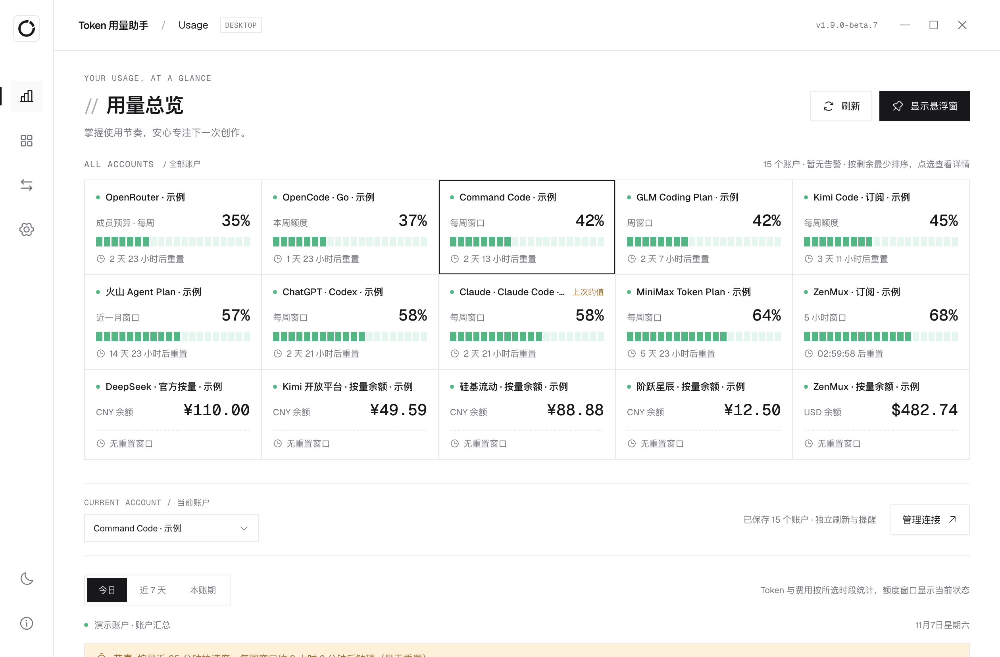

# Token Usage Assistant (Token 用量助手)

[中文](README.md) · **English**

**A small local desktop app that shows, side by side, how much quota you have left on AI coding platforms and how many tokens your local coding tools actually used.** For Windows x64 and Apple Silicon macOS. Credentials stay on your machine, encrypted; no server, no telemetry, no model calls. Not an official client of any platform.

> **English interface:** every page, notifications, the tray and menus follow your system language (or Settings → Language); a few raw messages from platforms or tools may still be Chinese. It ships with the next release. This README, the [install guide](docs/INSTALL.md#english) and the [privacy notes](docs/PRIVACY.md#english) are available in English.

<picture>
  <source media="(prefers-color-scheme: dark)" srcset="docs/readme/overview-dark.png">
  
</picture>

<sub>The screenshot uses the app's built-in sample data, not a real account.</sub>

**[Download](https://github.com/junjunup/TokenUsageAssistant/releases)**: Windows Setup / Portable, macOS DMG / ZIP, with SHA256 checksums. Installing and first launch: see [Install and upgrade](docs/INSTALL.md#english).

Current version: **1.9.0-beta.6** (beta, not signed or notarized). History: [CHANGELOG.md](CHANGELOG.md) (Chinese).

## What it does

- **Platform quota and balance**: what is left in each 5-hour / weekly / monthly window and when it resets; the balance of pay-as-you-go platforms (with optional reminder amounts, set separately for CNY and USD); optionally the official service status of Anthropic, OpenAI, Moonshot and MiniMax. Up to 20 accounts, each refreshed and alerted on its own.
- **Local tool usage**: tokens, requests, models and projects for Codex, Claude Code, Gemini CLI, Kimi Code CLI, Qwen Code, Cline, Kilo Code, Goose, Crush, Zcode, OpenCode and DeepSeek Harness; optional cost estimates from prices you enter (USD and CNY kept apart); records can be exported as CSV, and an optional `tua-status` command prints every account's quota as JSON or text.
- **At a glance**: macOS menu bar icon and panel, Windows tray, an always-on-top floating window; light and dark themes.
- **Honest numbers**: missing data shows "—", never 0; platform quotas and local usage are never added together; no comparison when coverage is incomplete.

## Supported platforms and tools

Verification levels: **Live-tested** = verified read-only against a real account; **Sample-tested** = tested only with official API samples or synthetic data, not reconciled against a real account. The app shows the same label next to each platform. Compared a platform with your own account? Please send a [platform verification report](https://github.com/junjunup/token-usage-assistant/issues/new?template=verification.yml): just whether it matches and what differs, no keys or account details.

| Kind | Name | How it reads | Verification |
|---|---|---|---|
| Platform quota | Command Code | Official usage API | Live-tested (real account snapshot on Windows; not reconciled line by line with the website) |
| Platform quota | GLM Coding Plan (China / international) | Official quota API | Sample-tested |
| Platform quota | MiniMax Token Plan (China / international) | Official quota API | Sample-tested |
| Platform quota | Volcengine personal Agent Plan (Beijing) | Official AFP quota API | Sample-tested |
| Platform quota | OpenCode Go | Official usage API (percentages for three periods) | Sample-tested |
| Platform quota | Kimi Code subscription (China / international) | **Unofficial endpoint** (Kimi publishes no documentation; 5-hour, weekly and monthly percentages) | Sample-tested (samples from third-party tools) |
| Plan quota | ZenMux subscription | Official management API (5-hour and 7-day usage; needs a Management API Key) | Sample-tested |
| Balance | DeepSeek | Official balance API | Sample-tested |
| Balance | Kimi open platform (China / international) | Official balance API | Sample-tested |
| Pay-as-you-go balance | SiliconFlow (China / international) | Official user info API (granted and topped-up parts read from the official example) | Sample-tested |
| Pay-as-you-go balance | StepFun (China) | Official account API (available balance; Step Plan quota has no query API) | Sample-tested |
| Pay-as-you-go balance | ZenMux | Official management API (USD balance; needs a Management API Key) | Sample-tested |
| Key limit and spend | OpenRouter | Official key API (this key's limit, budgets, reported spend) | Sample-tested |
| Subscription quota | ChatGPT · Codex | Read-only methods of the local official Codex program | Live-tested (Windows, read-only query of a Pro account) |
| Subscription quota | Claude · Claude Code | Status line + local OTLP component | Live-tested (macOS, quota and usage sync; not reconciled with the website) |
| Tool usage | Zcode | Read-only SQLite metadata | Live-tested (real database on Windows) |
| Tool usage | OpenCode | Read-only SQLite metadata | Sample-tested |
| Tool usage | Codex, Claude Code | Usage metadata from local rollout files / OTLP events | Sample-tested |
| Tool usage | Claude Code session logs | Per-reply usage counts in the session files Claude Code itself writes (no launcher needed; de-duplicated against the launcher source by request id) | Live-tested (macOS, local logs read; not reconciled with the website) |
| Tool usage | Gemini CLI | Per-reply usage counts in local session files (structure from the official open-source code) | Sample-tested |
| Tool usage | Kimi Code CLI | Per-call usage records in local sessions (structure from the official open-source code) | Sample-tested |
| Tool usage | Qwen Code | Per-reply usage counts in local session files (structure from the official open-source code) | Sample-tested |
| Tool usage | Cline | Per-turn usage counts in local session files (structure from the official open-source code) | Sample-tested |
| Tool usage | Kilo Code | Usage metadata in kilo.db (same structure as OpenCode) | Sample-tested |
| Tool usage | Goose, Crush | Each session's accumulated usage in the local database (session totals, not requests) | Sample-tested |
| Tool usage | DeepSeek Harness | Optional local plugin export | Sample-tested (plus contract tests on the official runtime) |

Tool updates keep working: the app trusts the data structure, not the version number, so a new version is counted as usual while its core usage fields are unchanged, and a change in fields is flagged on the source card. A weekly job also checks new upstream versions for compatibility (Codex, Harness).

Missing a platform you use? [Open an issue](https://github.com/junjunup/token-usage-assistant/issues/new/choose).

## Privacy

- Only fixed, official **read-only** APIs are called. Conversation text, prompts, replies, tool content and credentials are never read or exported; third-party databases are opened read-only.
- You enter credentials in the app yourself; they are encrypted with the system's facilities (Windows DPAPI, macOS Keychain).
- No server and no telemetry. Diagnostics are exported only when you ask, contain no content or credentials, and are previewed before saving.

What is read, where it is stored and which addresses are contacted: **[Privacy](docs/PRIVACY.md#english)**.

## Install

Full steps, upgrades, checking downloads and FAQ: **[Install and upgrade](docs/INSTALL.md#english)**.

- **Windows (x64)**: `TokenUsageAssistant-Setup-<version>.exe` or `TokenUsageAssistant-Portable-<version>.exe`; no Node.js needed. The program is unsigned (see [Code signing](docs/CODE-SIGNING.md#english)); if you see "Windows protected your PC", click **More info → Run anyway**.
- **macOS (Apple Silicon, macOS 13+)**: drag "Token 用量助手" from the DMG into Applications. On first launch the dialog has no Open button: close it, then click **Open Anyway** in **System Settings → Privacy & Security**. Once per version; an upgrade may ask for Keychain access once.

## Using it

1. Add platform accounts under 「账户与设置」 (Accounts & settings). Enter credentials only in the app, never in a chat.
2. Connect local coding tools under 「工具数据源」 (Tool sources).
3. Filter by time, model, project and session under 「用量分析」 (Usage analysis); model prices can be set in USD or CNY.
4. Closing the main window keeps the app in the menu bar / tray; it refreshes every 60 seconds by default.

## How numbers are counted

- Missing values show "—", not 0; `resetAt=0` shows "not started" with no made-up countdown.
- Platform quotas and tool usage are never added together. Tool records belong to no account unless you confirm an association rule.
- USD and CNY are kept apart and never converted; a drop in balance is not treated as spending; local costs are estimates from your prices, not bills.
- Tools count **reported usage**: failed or cancelled requests count if they reported usage; cache and reasoning sub-counts are not double-counted in totals.
- With incomplete coverage there is no comparison and no error rate.

Full rules (Chinese): [AGENTS.md](AGENTS.md).

## Development

Node 24.x, pnpm 11.19.0, Electron 44.9.3 (locked in `pnpm-lock.yaml`).

```bash
pnpm install
pnpm run dev               # browser preview (sample data)
pnpm run test:desktop      # desktop and analytics tests (baseline: 390 pass / 0 fail / 6 skipped locally; 396 / 0 / 0 in CI with Harness runtimes)
pnpm run lint              # ESLint
pnpm run typecheck         # strict type check of the pure domain modules (required in CI)
pnpm run format:check      # Prettier (pnpm run format to fix)
pnpm run build             # build dist/client (required after UI changes)
```

- **Native smoke test**: `pnpm exec electron . --smoke-test --test-directory="$(mktemp -d)"` — always a fresh, isolated directory.
- **macOS dev build**: `pnpm run desktop` uses its own data directory `~/Library/Application Support/TokenUsageAssistant-Dev` and its own Keychain item, separate from the packaged app.
- **macOS packaging** (arm64 Mac only): `scripts/Build-Mac-App.command`, then `scripts/Verify-Mac-Native.command` to check signing and fuses and run the packaged smoke test. Release installers are built by the CI Release workflow; see [docs/RELEASING.md](docs/RELEASING.md) (Chinese).
- **Generated files**: `src/generated/` is produced by `scripts/prepare-analytics-preview.mjs`; edit the matching pure module under `desktop/` instead.
- **Harness tests** need the official test runtimes installed in isolation as described in the [plugin README](integrations/deepseek-harness/README.md); without them those tests are skipped, and skipped is not passed.
- Contributing: [CONTRIBUTING.md](CONTRIBUTING.md#english).

## License and notices

- [MIT License](LICENSE). Third-party components in the installers and their licenses: [THIRD_PARTY_NOTICES.md](THIRD_PARTY_NOTICES.md), [THIRD_PARTY_LICENSES.txt](THIRD_PARTY_LICENSES.txt).
- Platform and tool names belong to their owners; this project is not affiliated with or endorsed by them.
- Report security issues privately as described in [SECURITY.md](SECURITY.md); never post API keys, tokens or account details in a public issue.
