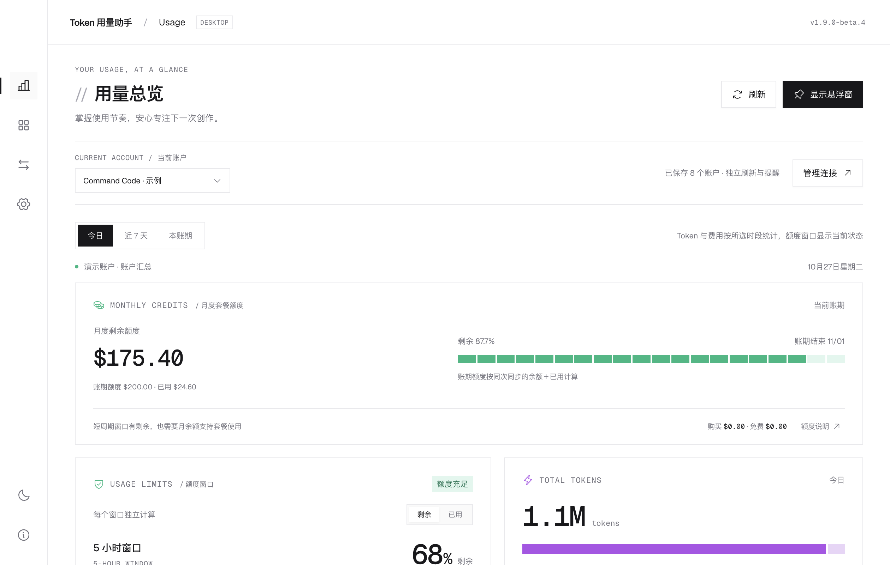

# Token 用量助手

**中文** · [English](README.en.md)

**一个本机桌面小工具：同时看清 AI 编程平台的剩余额度，和你本机编程工具实际用掉的 Token。** 支持 Windows x64 与 Apple Silicon macOS；凭据只保存在本机并加密，没有服务器、不收集遥测、不调用任何模型。非任何平台的官方客户端。

<picture>
  <source media="(prefers-color-scheme: dark)" srcset="docs/readme/overview-dark.png">
  
</picture>

<sub>截图使用应用内置的示例数据，不是真实账户。</sub>

**[下载安装包](https://github.com/junjunup/TokenUsageAssistant/releases)**：Windows 安装版 / 便携版、macOS DMG / ZIP，附 SHA256 校验。安装与首次打开见 [安装与升级](docs/INSTALL.md)。

当前版本：**1.9.0-beta.5**（开发测试版，未签名、未公证）。更新历史见 [CHANGELOG.md](CHANGELOG.md)。

## 能做什么

- **平台额度与余额**：5 小时 / 每周 / 月度窗口剩余多少、什么时候重置；按量平台的余额。多个账户（最多 20 个）各自刷新、各自提醒。
- **本机工具用量**：Codex、Claude Code、Zcode、OpenCode、DeepSeek Harness 的 Token、请求、模型与项目分布；可按自己填的单价估算费用（USD / CNY 分开）。
- **随时瞄一眼**：Mac 菜单栏图标与面板、Windows 托盘、置顶悬浮窗；深浅色主题。
- **说实话**：数据缺失显示「—」而不是 0；平台额度和本机用量各算各的、不相加；覆盖不全时不做对比。

## 支持的平台与工具

验证等级：**已实测** = 用真实账户只读验证过；**样例验证** = 只用官方接口样例或合成数据测试过，没和真实账户核对。应用里每个平台旁也会显示这个标签。

| 类型 | 名称 | 读取方式 | 验证等级 |
|---|---|---|---|
| 平台额度 | Command Code | 官方用量接口 | 已实测（Windows 真实账户快照；未与官网逐项核账） |
| 平台额度 | GLM Coding Plan（国内 / 国际） | 官方额度接口 | 样例验证 |
| 平台额度 | MiniMax Token Plan（国内 / 国际） | 官方额度接口 | 样例验证 |
| 平台额度 | 火山个人 Agent Plan（北京） | 官方 AFP 额度接口 | 样例验证 |
| 平台额度 | OpenCode Go | 官方用量接口（三个周期的百分比） | 样例验证 |
| 按量余额 | DeepSeek | 官方余额接口 | 样例验证 |
| 按量余额 | Kimi 开放平台（国内 / 国际） | 官方余额接口 | 样例验证 |
| 订阅额度 | ChatGPT · Codex | 本机官方 Codex 程序的只读方法 | 已实测（Windows，Pro 账户只读查询） |
| 订阅额度 | Claude · Claude Code | 状态栏 + 本机 OTLP 组件 | 已实测（Mac，额度与用量同步；未与官网核账） |
| 工具用量 | Zcode | 只读 SQLite 元数据 | 已实测（Windows 真实数据库） |
| 工具用量 | OpenCode | 只读 SQLite 元数据 | 样例验证 |
| 工具用量 | Codex、Claude Code | 本机 rollout 文件 / OTLP 事件的用量元数据 | 样例验证 |
| 工具用量 | DeepSeek Harness | 可选本机插件导出 | 样例验证（另在官方运行时上跑契约测试） |

编程工具升级后照样能读：应用按数据结构而不是版本号判断，新版本只要核心用量字段没变就照常统计；字段有变化时会在来源卡片上提示。每周还会自动检查上游新版本是否兼容（Codex、Harness）。

想要的平台不在表里？请[提 issue](https://github.com/junjunup/token-usage-assistant/issues/new/choose)。

## 隐私

- 只调用固定的官方**只读**接口；不读取、不导出对话正文、提示词、回复、工具内容或凭据；第三方数据库只读。
- 凭据只在应用里由你自己填写，用系统能力加密保存（Windows DPAPI、macOS 钥匙串）。
- 没有服务器、没有遥测；诊断信息由你手动导出，里面不含任何内容和凭据。

逐项说明（读什么、存在哪、连哪些地址）见 **[隐私说明](docs/PRIVACY.md)**（中英文）。

## 安装

完整步骤、升级、核对下载文件和常见问题见 **[安装与升级](docs/INSTALL.md)**（中英文）。

- **Windows（x64）**：安装版 `TokenUsageAssistant-Setup-<版本>.exe` 或便携版 `TokenUsageAssistant-Portable-<版本>.exe`，不需要 Node.js。程序未签名，如果看到「Windows 已保护你的电脑」，点「更多信息 → 仍要运行」。
- **macOS（Apple Silicon，macOS 13+）**：把 DMG 里的「Token 用量助手」拖进「应用程序」。首次打开时弹窗里没有「打开」按钮：关掉提示，到「系统设置 → 隐私与安全性」点「仍要打开」。同一版本只需操作一次；升级后可能弹一次钥匙串授权。

## 使用要点

1. 在「账户与设置」添加平台账户。凭据只在应用内填写，不要发到聊天里。
2. 在「工具数据源」连接本机编程工具。
3. 在「用量分析」按时间、模型、项目、会话筛选；模型单价可以分别按 USD / CNY 配置。
4. 关闭主窗口后，应用继续留在菜单栏 / 托盘，默认每 60 秒刷新一次。

## 数据口径

- 缺失显示「—」，不显示 0；`resetAt=0` 显示「未启用」，不编造倒计时。
- 平台额度和工具用量不相加。工具记录默认不归属任何账户，只有你确认过的关联规则才会归属。
- USD 与 CNY 分开，不换汇；余额差不当作消费；本机费用只是按你的单价估算，不是账单。
- 工具采用「已报告用量」：失败或取消的请求如果报告了用量也会计入；缓存和推理子项不重复计入总量。
- 覆盖范围不足时不做对比，也不给出误差率。

完整规则见 [AGENTS.md](AGENTS.md)。

## 开发

环境：Node 24.x、pnpm 11.19.0、Electron 44.9.3（依赖锁定在 `pnpm-lock.yaml`）。

```bash
pnpm install
pnpm run dev               # 浏览器预览（示例数据）
pnpm run test:desktop      # 桌面与分析测试（基线：本机 383 通过 / 0 失败 / 6 跳过；CI 装了 Harness 运行时，389 / 0 / 0）
pnpm run lint              # ESLint
pnpm run typecheck         # 纯领域模块的严格类型检查（CI 必跑）
pnpm run format:check      # Prettier 检查（pnpm run format 自动格式化）
pnpm run build             # 构建 dist/client（改动界面后必须重新构建）
```

- **原生 smoke**：`pnpm exec electron . --smoke-test --test-directory="$(mktemp -d)"`，必须使用新建的隔离目录。
- **Mac 开发版**：`pnpm run desktop` 使用独立的数据目录 `~/Library/Application Support/TokenUsageAssistant-Dev` 和独立的钥匙串条目，不读写打包版的数据。
- **Mac 打包**（只能在 arm64 Mac 上）：`scripts/Build-Mac-App.command`，再用 `scripts/Verify-Mac-Native.command` 校验签名、fuses 并跑打包后的 smoke。正式安装包由 CI 的 Release 工作流产出，见 [docs/RELEASING.md](docs/RELEASING.md)。
- **生成文件**：`src/generated/` 由 `scripts/prepare-analytics-preview.mjs` 生成，要改就改 `desktop/` 下对应的纯模块。
- **Harness 测试**：需要按[插件说明](integrations/deepseek-harness/README.md)隔离安装官方测试运行时并设置环境变量；没有设置时这几项会跳过，跳过不算通过。
- 参与贡献请看 [CONTRIBUTING.md](CONTRIBUTING.md)。

## 文档索引

| 文档 | 内容 |
|---|---|
| [docs/INSTALL.md](docs/INSTALL.md) | 安装、升级、核对下载、常见问题（中英文） |
| [docs/PRIVACY.md](docs/PRIVACY.md) | 隐私说明（中英文） |
| [AGENTS.md](AGENTS.md) | 长期有效的项目规则（数据语义、隐私、契约、交付、UI、测试） |
| [IMPROVEMENT_PLAN.md](IMPROVEMENT_PLAN.md) | 当前改进计划、用户决策、执行记录 |
| [PROJECT_HANDOFF.md](PROJECT_HANDOFF.md) | 当前状态快照 |
| [CHANGELOG.md](CHANGELOG.md) | 版本历史 |
| [docs/research/](docs/research/) | 调研：上游工具契约、新平台候选 |
| [docs/history/](docs/history/) | 归档的旧版文档 |

## 许可与声明

- 本项目以 [MIT 许可证](LICENSE) 开源；安装包中的第三方组件及其许可证见 [THIRD_PARTY_NOTICES.md](THIRD_PARTY_NOTICES.md) 与 [THIRD_PARTY_LICENSES.txt](THIRD_PARTY_LICENSES.txt)。
- 文中提到的平台和工具名称归各自所有者所有，本项目与它们没有隶属或授权关系。
- 安全问题请按 [SECURITY.md](SECURITY.md) 私下报告，不要在公开 issue 里贴 API Key、令牌或账户信息。
